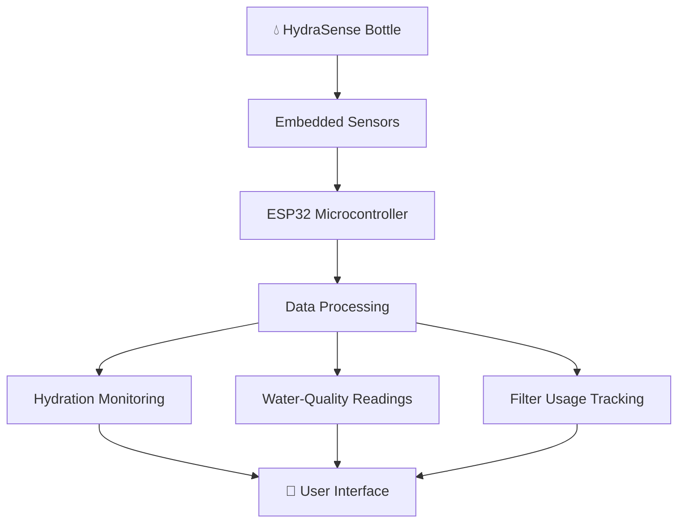

# 💧 HydraSense — Smart Water Bottle

<p align="center">
  
  
  
</p>

<p align="center">
  <b>Smarter Hydration. Better Awareness. Connected Living.</b>
  <br/>
  An intelligent water bottle that brings hydration tracking, water-quality sensing, and filter usage monitoring together in one portable system.
</p>

---

## 🌊 About HydraSense

**HydraSense** is a third-year Embedded Systems project developed at the Department of Computer Engineering, University of Peradeniya, Sri Lanka.

Traditional water bottles store water, but they do not tell us how much we drink, provide electronic measurements of selected water-quality parameters, or help us track filter usage.

HydraSense explores a smarter approach by integrating an embedded sensing system, a replaceable built-in filter, and connected monitoring features into a single bottle.

Our goal is to develop a practical prototype that helps users understand their hydration habits, observe relevant sensor readings, and manage filter replacement more conveniently.

> 💡 **Our vision:** Turn an everyday water bottle into an intelligent hydration companion.

## ✨ Key Features

<table>
  <tr>
    <td width="50%" valign="top">
      <h3>💧 Hydration Tracking</h3>
      Monitor changes in bottle weight to estimate water consumption and help users understand their daily drinking habits.
    </td>
    <td width="50%" valign="top">
      <h3>🔬 Water-Quality Sensing</h3>
      Integrate sensors for selected parameters such as temperature, pH, total dissolved solids (TDS), and turbidity.
    </td>
  </tr>
  <tr>
    <td width="50%" valign="top">
      <h3>♻️ Filter Usage Monitoring</h3>
      Track estimated filter usage and provide replacement reminders based on configured usage limits.
    </td>
    <td width="50%" valign="top">
      <h3>📱 Connected Monitoring</h3>
      Explore Bluetooth or Wi-Fi connectivity for viewing measurements and hydration information through a user interface.
    </td>
  </tr>
</table>

## ⚙️ How It Works

HydraSense combines sensing, embedded processing, and user feedback to support smart hydration monitoring.



*The diagram illustrates the intended system architecture. Final connections and implemented features may change during prototype development.*

## 🧪 Technologies & Components

| Category | Technologies / Components |
|---|---|
| Microcontroller | ESP32 |
| Hydration sensing | Load cell and weight measurement |
| Water-quality sensing | Temperature, pH, TDS, and turbidity sensors |
| Connectivity | Bluetooth / Wi-Fi |
| Filtration | Replaceable internal filter |
| Development | Embedded programming, sensor integration, and circuit testing |

*The component list represents the planned system design and should be updated to reflect the hardware and software actually implemented.*

## 🎯 Project Objectives

- Develop an embedded system for monitoring water consumption.
- Integrate sensors for measuring selected water-quality parameters.
- Implement a method for estimating filter usage and indicating replacement needs.
- Explore wireless communication for convenient access to system measurements.
- Build a compact and practical smart bottle prototype.
- Evaluate the accuracy, reliability, and limitations of the implemented features.

## 👥 Meet the Team

We are a team of Computer Engineering undergraduates at the University of Peradeniya, working together to explore embedded systems, sensing technologies, and connected devices.

<table>
  <tr>
    <td align="center" width="25%">
      <b>H. M. H. N. Aberathna</b>
      <br/><br/>
      <code>E/22/001</code>
      <br/>
      <a href="mailto:e22001@eng.pdn.ac.lk">Email</a>
    </td>
    <td align="center" width="25%">
      <b>M. A. N. P. Anawarathne</b>
      <br/><br/>
      <code>E/22/027</code>
      <br/>
      <a href="mailto:e22027@eng.pdn.ac.lk">Email</a>
    </td>
    <td align="center" width="25%">
      <b>A. S. V. Gunasiri</b>
      <br/><br/>
      <code>E/22/120</code>
      <br/>
      <a href="mailto:e22120@eng.pdn.ac.lk">Email</a>
    </td>
    <td align="center" width="25%">
      <b>P. H. D. Rathnasiri</b>
      <br/><br/>
      <code>E/22/324</code>
      <br/>
      <a href="mailto:e22324@eng.pdn.ac.lk">Email</a>
    </td>
  </tr>
</table>

## 🚀 Development Roadmap

- [ ] Finalize system requirements and hardware design
- [ ] Integrate the microcontroller and sensors
- [ ] Implement hydration measurement and consumption estimation
- [ ] Integrate water-quality sensing
- [ ] Implement filter usage tracking
- [ ] Develop the user interface and wireless communication
- [ ] Test individual components and the integrated prototype
- [ ] Document results, limitations, and future improvements

*Update the checklist as each milestone is completed.*

## 🔍 Testing & Validation

Testing will focus on the functionality and reliability of the integrated system.

- **Hydration tracking:** Compare estimated consumption against measured reference volumes.
- **Sensor performance:** Evaluate readings against appropriate reference instruments or calibration procedures.
- **Filter monitoring:** Verify usage calculations and replacement reminders.
- **System integration:** Test communication, power consumption, and operation under normal use conditions.

Sensor readings alone do not establish that water is safe to drink. Any claims about contaminant removal or filter effectiveness require appropriate independent testing.

## 📂 Repository Structure

```text
HydraSense/
├── docs/
│   ├── index.json
│   └── _config.yml
├── README.md
└── [source code and hardware files]
```

The repository will contain project documentation, embedded software, hardware designs, and testing resources as development progresses.

## 🔮 Future Possibilities

- Personalized hydration goals and reminders
- Historical hydration data and visual dashboards
- Improved sensor calibration and measurement accuracy
- Battery-life optimization and compact circuit integration
- More detailed filter maintenance and performance monitoring

## 🎓 Acknowledgements

Developed as part of the Embedded Systems project programme at the **Department of Computer Engineering, Faculty of Engineering, University of Peradeniya, Sri Lanka**.

---

<p align="center">
  <b>💧 HydraSense — Making Every Sip Count.</b>
  <br/><br/>
  <i>Engineering a smarter way to stay hydrated.</i>
</p>
